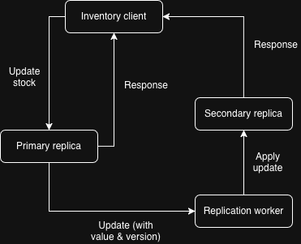

# CMPE 273 Lab 8 — Primary/Secondary Inventory Replication

This lab has one Primary replica, one Secondary replica, and a client that can
read either replica. Both start with `stock = 10`. Updates go to the Primary
and are asynchronously propagated to the Secondary.



## 1. Run the program

```bash
python3 demo.py
```

The demo runs all three scenarios, verifies the observed values, and exits with
an error if a check fails or replication does not complete within five seconds.
The worker shuts down automatically when the demo finishes.

## 2. Replication

`inventory.py` owns the replicas and replication worker. `client.py` provides
`read("primary")`, `read("secondary")`, and `update(stock)`. The update method
always writes to the Primary; the Secondary has no client write operation.
Stock must be a nonnegative integer.

Each write increments a version and queues an immutable copy of the Primary's
new value. The worker applies queued values to the Secondary in order. A write
returns once the Primary accepts it; it does not wait for the Secondary.
The demo explicitly waits for replication before checking convergence.

The first scenario updates stock to `12` and produces:

```text
=== 1. Normal replication: stock=12 ===
Primary accepted: stock=12, version=1
Primary: stock=12, version=1
Secondary: stock=12, version=1
PASS: both replicas received the new value
```


## 3. Stale read

The demo resets both replicas to `10` at version 2, waits for that update to
replicate, and pauses delivery to the Secondary. It then writes `9` to the
Primary and reads both replicas through the client:

```text
=== 2. Stale read: pause replication, then write stock=9 ===
Baseline: both replicas have stock=10
Replication paused
Primary: stock=9, version=3
Secondary: stock=10, version=2
PASS: Secondary returns a stale read (10 while Primary returns 9)
```


The Secondary's `10` is a **stale read** because the Primary has already accepted
`9`. Pausing holds updates in the queue until replication resumes, making this
scenario reproducible without relying on the speed of the machine.

## 4. Recovery and convergence

Resuming replication wakes the worker, which delivers the queued update. The
demo waits for version 3 and reads both replicas again:

```text
=== 3. Recovery: resume replication ===
Primary: stock=9, version=3
Secondary: stock=9, version=3
PASS: both replicas converged to stock=9
```


This demonstrates eventual consistency: a Secondary read can lag behind a
successful write, but the replicas converge once delivery resumes.

## 5. Reflection

Reading quickly from a replica can sometimes present stale data, when the update from primary has not propagate to secondary replicas. 
Reading from out of sync secondary replicas may return an old value though the primary and other secondary replicas have more
recent value. The advantage of this is that it allows quick reads because it doesn't check with other replicas to see if a value is the latest. If we want to guarantee that a read always return the latest value, the system may take more time to check the version with other replicas, then return the value with the highest version number.
